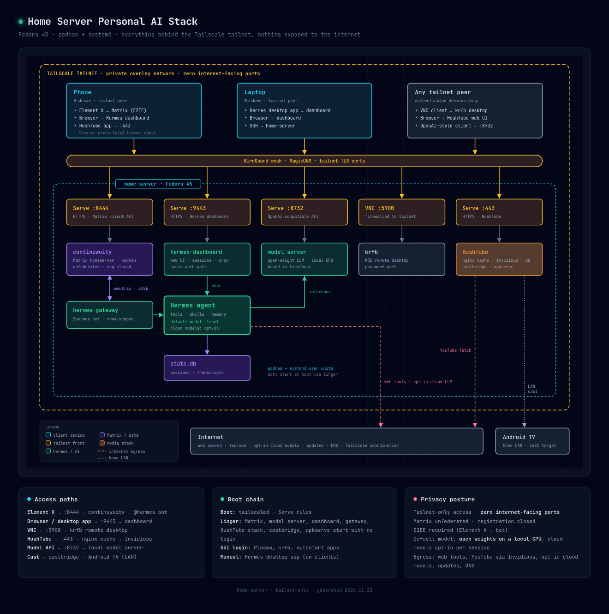

# Daryl Melton

Network operations and communications supervisor in the U.S. Air Force (Special Warfare), moving into cybersecurity, networking, and AI-enabled automation. B.A. Computer Science, CU Boulder. Network+ · Security+ (Dec 2026).

## What I'm building

**[HushTube](https://github.com/dsmelton/hushtube)**: a self-hosted private YouTube proxy with a native Android app. A Linux desktop at home fetches everything so my phone never talks to Google. Nothing is exposed to the internet; access is Tailscale-only with TLS. An end-to-end verify script checks real video bytes, not just container health.
`Kotlin` `Media3/ExoPlayer` `Flask` `Podman` `Invidious` `PostgreSQL` `nginx` `Tailscale` `SELinux`

**Home AI server**: the same desktop also runs a quantized open-weight model on its own GPU, plus Hermes Agent, which I use as a self-hosted coding agent. I reach it from my phone over end-to-end encrypted Matrix (on a homeserver I host, with federation off and registration closed) or from a web dashboard. Every service is reachable only over Tailscale, and nothing is exposed to the internet. The agent uses the local model by default, and cloud models are opt-in per session. It all runs on one machine with no redundancy, and everything except remote desktop comes back on its own after a reboot.
`Fedora` `Podman` `systemd` `Tailscale` `Matrix` `local LLMs`

<a href="https://dsmelton.github.io/home-ai-stack/">Interactive version (zoom and pan)</a> · <a href="assets/home-ai-stack.html">HTML source</a>

## Work tools (not public)

**Automated Report-Drop Simulator**: a desktop app that releases timed situation reports into IRC chat rooms during training exercises, replacing manual copy-paste by exercise controllers. Three timing modes (scheduled, fixed interval, randomized), sequential/random/shuffle ordering, dry-run and schedule previews, flood-control pacing, and a GUI for non-technical users. Ships as a single Windows .exe for offline, air-gapped machines.
`Python` `IRC` `GUI` `PyInstaller`

**Network Configuration Generator**: offline Python tool that generates router, switch, and radio configurations for a mobile network stack. It has saved 100 hours of manual configuration and lets operators restore a dropped configuration right away.

**RAG reference tool**: a self-hosted LLM that consolidates technical manuals and procedures from 12+ sources into one searchable resource, with no documents sent to outside AI services.

## How I work

I build with agentic AI workflows. The architecture, review, and hard debugging are mine, and coding agents do the typing. Every change gets verified before it ships, and failures get written up with the root cause and fix.

## Tools

Python · Kotlin · Linux · Cisco IOS · Podman/containers · Flask · PostgreSQL · nginx · Tailscale/VPN · RAG · local LLMs

## Contact

[LinkedIn](https://www.linkedin.com/in/daryl-melton) · Open to SkillBridge (Jan–May 2027) and full-time roles in San Antonio, TX
